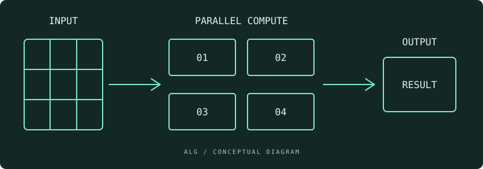

---

title: 'GPUではじめる、小さな機械学習実験'
description: 'GPUの並列計算を知るところから。小さな行列演算を題材に、実験の進め方を考えます。'
publishedAt: 2026-10-25
authors: [alg]
category: tech
tags: [gpu, ai, python]
featured: true
---

> この記事はサイト開発用のサンプルです。ALGの実際の活動実績を示すものではありません。

## GPUは何が得意？

GPUは、多くのデータに同じような計算を繰り返す処理を得意としています。機械学習でよく登場する行列演算も、そのひとつです。

CPUとGPUの違いを体感するには、大きなモデルを動かす前に、小さな計算から始めると結果を整理しやすくなります。



## まずは計算の流れをつかむ

以下は、行列積の考え方を確認するためのPythonコードです。GPUを使うコードではありません。

```python
# 2 × 2 の行列積を、基本的な処理で確認する
left = [[1, 2], [3, 4]]
right = [[5, 6], [7, 8]]

result = [
    [sum(left[i][k] * right[k][j] for k in range(2)) for j in range(2)]
    for i in range(2)
]
print(result)  # [[19, 22], [43, 50]]
```

### 測定するときのチェックリスト

- [ ] 実行環境とバージョンを記録する
- [ ] 入力のサイズとデータ型を揃える
- [ ] 初回実行と繰り返し実行を区別する
- [ ] GPU処理の完了を待ってから測定する

| 観点 | 記録する内容                 |
| ---- | ---------------------------- |
| 環境 | CPU・GPU・メモリ、使用ツール |
| 入力 | 行列の大きさ、データ型       |
| 結果 | 実行時間、試行回数、ばらつき |

## 実験から、次の疑問へ

速さだけでなく、どの条件で差が出るのかを考えることが大切です。結果が予想と違ったときこそ、次の調査の出発点になります。

学んだことは短いメモでもかまいません。実行条件と一緒に残し、次の実験につなげましょう。[^note]

[^note]: 実際にGPUを利用する際は、使用する機器・ライブラリの公式ドキュメントを確認してください。
