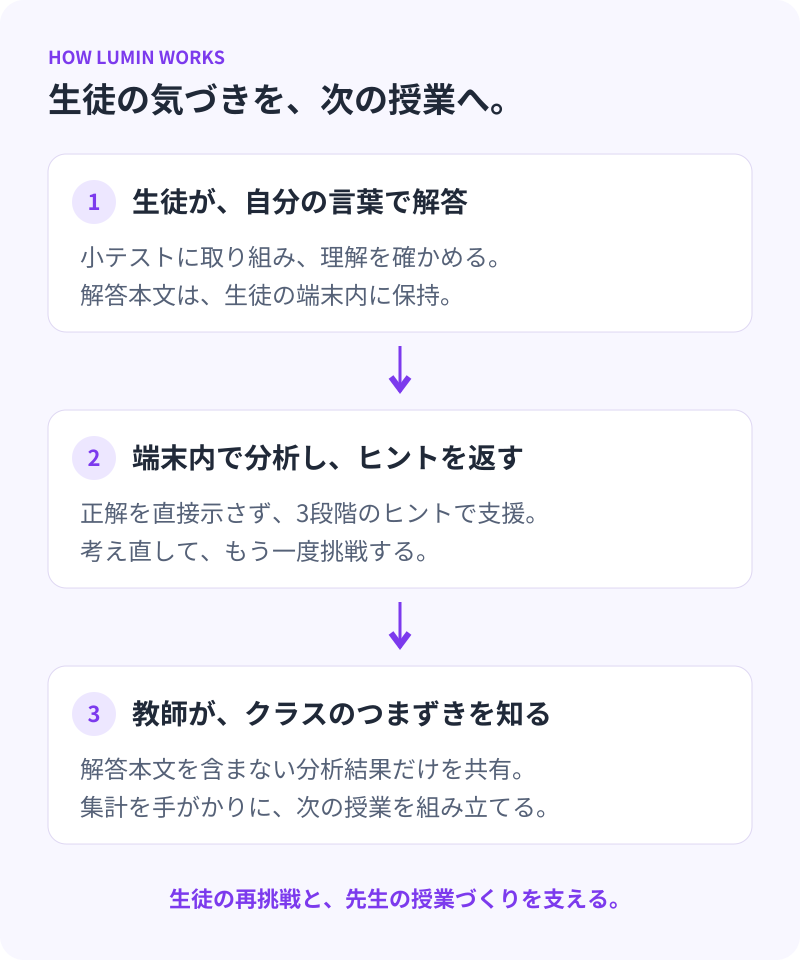
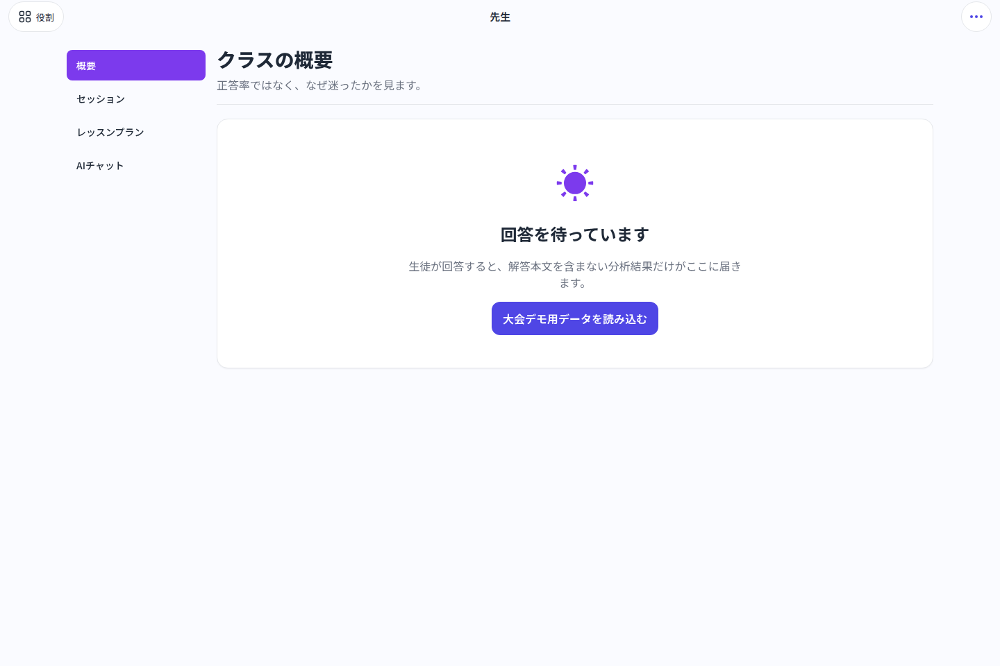

---

title: 'Lumin'
description: '端末内で解答を分析して段階的なヒントを返し、クラスのつまずきを教師に共有する学習支援アプリ。SBMCビジネスアイデア部門で銅賞を受賞。'
status: active
technologies: [Tauri, Rust, React, TypeScript, ONNX Runtime]
authors: [alg]
repositoryUrl: https://github.com/ALG-SIT/Lumin
cover: ../../assets/lumin/start.png
coverAlt: Luminの実際の起動画面。先生・生徒・デモの3つの役割を選択できます。
featured: true
---

## 理解を照らし、次の学びにつなげる

Luminは、生徒の解答を端末内で分析し、段階的なヒントで学習を支援するアプリです。解答本文を送らずに、クラス全体でどのような理解のつまずきがあるかを教師へ共有します。

起動画面は、[Luminのソースコード](https://github.com/ALG-SIT/Lumin/tree/388c9931eab59920bef15e42de2bbfb85f69dd92)を動かしたブラウザプレビューの実画面です。

## 生徒と教師をつなぐ

生徒には正解を直接示すのではなく、3段階のヒントで再挑戦を促します。教師は正答率やつまずきの傾向を確認し、次の授業の進め方を考える手がかりにできます。

教師モードと生徒モードを備え、同じローカルネットワーク上の端末で教室セッションを構成します。Tauri・Rust・Reactを用いた大会用MVPとして開発を進めています。

## 教師ダッシュボードの実画面

教師モードでは、クラスの概要や小テストの配信、授業案を確認する画面を切り替えます。上の画像はブラウザプレビューの回答待ち状態です。実際の教室通信やAI推論を実行した結果ではありません。

## SBMCビジネスアイデア部門で銅賞

2026年9月27日に豊洲キャンパスで開催された第11回芝浦ビジネスモデルコンペティション（SBMC）のビジネスアイデア部門最終発表会で、ALGメンバーのチーム「Luminous Studying」が提案した「Lumin」が銅賞を受賞しました。

受賞については[芝浦工業大学の公式記事](https://www.shibaura-it.ac.jp/headline/detail/20260927_7070_2.html)で紹介されています。

## ソースコード

機能や開発状況は[GitHubリポジトリ（ALG-SIT/Lumin）](https://github.com/ALG-SIT/Lumin)をご覧ください。
